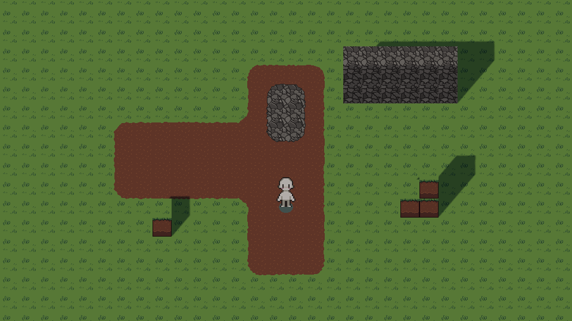
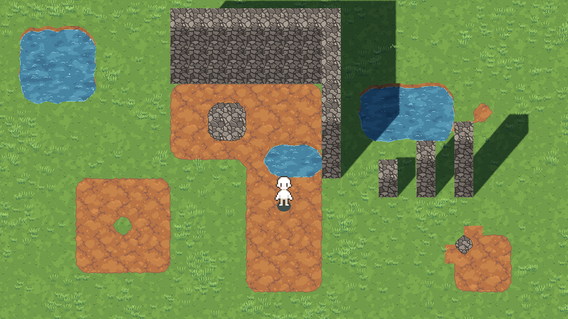

# 02 · Pintar el mapa

Aquí pintas el suelo (hierba, tierra, adoquín y agua) y pones muros y escalones de
bloques. Todo se hace con el **GridMap**, un pincel de casillas en 3D que viene con
Godot.

*Así queda en el juego un camino de tierra con adoquín en medio, un muro de
piedra de dos plantas y unos bloques de césped.*

## Cómo está montado el pueblo

Abre `scenes/world/village.tscn`. En el panel Escena verás:

| Nodo | Para qué sirve |
|---|---|
| **Pueblo** | La escena entera. En su Inspector está el botón **Regenerar suelo** |
| WorldEnvironment, Sun | Luz ambiente y sol. No los toques de momento |
| **Terreno** | Donde **pintas el suelo** |
| **Bloques** | Donde pones **muros, escalones y terreno elevado** |
| **Parcela** | Donde pintas **la zona del laboratorio**, en la que irán los muebles |
| **Objetos** | Donde van árboles, casas y demás (guía 03) |
| **Muebles** | Donde van los muebles y las máquinas del laboratorio (guía 03) |
| Player, Camera3D | Personaje y cámara. En el juego, la cámara sigue al personaje |

Una **casilla** mide lo mismo que un bloque. En el editor no parece cuadrada, sino
un poco alargada hacia el fondo. Es a propósito: la cámara está inclinada y, vista
desde ella, cada casilla ocupa exactamente 32 × 32 píxeles de pantalla.

## La herramienta GridMap

Cuando seleccionas **Terreno** o **Bloques** en el panel Escena, aparecen dos cosas:

- **Una paleta** en el panel inferior, con las piezas que puedes pintar.
- **Una barra de herramientas** encima de la vista 3D, con estas herramientas:

| Herramienta | Tecla | Qué hace |
|---|---|---|
| **Pintar** (Paint) | **E** | Clic o clic y arrastrar para poner la pieza elegida |
| **Borrar** (Erase) | **W** | Clic o clic y arrastrar para quitar piezas |
| **Coger** (Pick) | **R** | Clic en una pieza ya puesta para elegirla en la paleta |
| **Seleccionar** (Selection) | **Q** | Arrastra para marcar un rectángulo |
| **Rellenar** (Fill) | **Z** | Llena el rectángulo marcado con la pieza elegida |
| **Borrar selección** (Delete) | **V** | Quita todo lo que haya en el rectángulo marcado |
| Planta anterior / siguiente | **1** / **3** | Baja o sube el plano en el que pintas. También **Ctrl + rueda** |

> Las teclas solo funcionan con el **ratón encima de la vista 3D**. Si no hacen
> nada, pulsa directamente el botón de la barra.

Mientras pintas en **Terreno** verás recuadros de color semitransparentes: verde
para la hierba, marrón para la tierra, gris para el adoquín y azul para el agua.
Son solo la brocha.
Debajo, el suelo de verdad se rehace solo, con sus bordes y transiciones, un
cuarto de segundo después de cada pincelada.

## Paso a paso: tu primer camino

1. En el panel Escena, selecciona **Terreno**.
2. En la paleta de abajo, haz clic en **dirt**.
3. Comprueba que la planta (Floor) es **0**.
4. Pon el ratón sobre la vista 3D y pulsa **E** para elegir Pintar.
5. Arrastra con el botón izquierdo para pintar un camino de **4 casillas de
   ancho** desde donde está el personaje hacia arriba.
6. Para ver solo el resultado final, haz clic en el **ojo** de **Terreno** en el
   panel Escena. Desaparecen los recuadros y queda el suelo tal como se verá en el
   juego. Vuelve a pulsar el ojo para seguir pintando.
7. Guarda con **Ctrl+S** y prueba con **F6**.

Para pintar una zona grande de golpe: **Q**, arrastra un rectángulo, elige el
terreno en la paleta y pulsa **Z**.

### Añade una plaza de adoquín

1. Elige **cobblestone** en la paleta.
2. Píntala **dentro** del camino de tierra, dejando al menos **una casilla de tierra
   alrededor**, también en las esquinas.

### Añade un estanque

1. Elige **water** en la paleta (es la última pieza, en azul).
2. Pinta las casillas de agua, por ejemplo un rectángulo de 4 × 3 con
   **Seleccionar** (Q) y **Rellenar** (Z).

El agua se ve **unos píxeles más baja** que el suelo y se mueve sola, también en
el editor: es agua de estanque, quieta, que se balancea un poco, con ondas que
aparecen y se desvanecen, destellos sueltos y una línea de espuma en la orilla.
En el borde de arriba asoma un escalón de tierra, que es lo que la hace
parecer un estanque y no una mancha azul. En el juego **no se puede entrar**: el
personaje se para en la orilla. Tampoco crece hierba dentro ni se pueden poner
muebles encima si cae en la parcela.

La orilla sale **redondeada** sola: tú pintas casillas y el juego redondea las
esquinas (hacia fuera y hacia dentro) y hace que el borde ondule un poco. Cuanto
más largos son los lados, más amplia es la curva: una casilla suelta es una charca
redonda y un estanque grande lleva esquinas de una casilla de radio. Dos casillas
de agua que solo se tocan por la esquina quedan como dos charcas separadas.

Puede tocar cualquier terreno: si un camino de tierra llega al agua, sigue recto
hasta la orilla.

En el Inspector de **Pueblo**, grupo **Agua**, puedes cambiar cuánto se hunde
(**Water Depth Texels**, en píxeles) y lo rápido que derivan las ondas (**Water
Ripple Speed**, en píxeles por segundo; 0 las deja quietas). Tras cambiarlos,
pulsa **Regenerar suelo**.

### Borrar

Con **W** borras lo pintado. Donde no hay nada pintado hay **hierba**, así que
borrar tierra y pintar hierba encima dan el mismo resultado.

## Las reglas del suelo

El dibujo del suelo solo sabe hacer transiciones entre **dos** terrenos a la vez.
Estas reglas hacen que quede bonito:

| Regla | Por qué |
|---|---|
| Los caminos, de **4 casillas de ancho** (3 como mínimo) | Media casilla de cada borde se usa para la transición. Con 1 o 2 casillas, el camino parece un collar de lentejas |
| Entre **adoquín** y **hierba**, siempre **al menos una casilla de tierra**, también en diagonal | Si el adoquín toca la hierba, esa esquina tiene tres terrenos y el dibujo tiene que simplificarla |
| El suelo se pinta solo en la **planta 0** | Para la altura están los bloques |

Si te saltas la segunda regla no se rompe nada, pero en el panel **Salida** aparece
este aviso:

> Suelo: N teselas con tres terrenos degradadas…

Quiere decir que hay N esquinas donde se tocan tres terrenos. Se dibujan igual, un
poco simplificadas. Para quitar el aviso, añade tierra entre el adoquín y la
hierba.

## Muros, escalones y terreno elevado: el GridMap Bloques

1. En el panel Escena, selecciona **Bloques**.
2. En la paleta, elige un bloque:
   - **cobblestone**: piedra;
   - **grass**: césped;
   - **dirt**: tierra;
   - **summer_grass**: césped de final de verano.
3. Con la planta **0**, pinta la primera fila del muro. Los bloques quedan
   apoyados en el suelo.
4. Pulsa **3** para subir a la planta **1** y pinta encima. Así se apilan.
5. Pulsa **1** para volver abajo.

Consejos:

- **No gires los bloques.** Las teclas **A**, **S** y **D** giran la pieza, pero
  como la casilla no es un cubo, un bloque girado se deforma y se sale de su sitio.
  Si has girado alguno sin querer, **Alt+G** quita el giro.
- Una escalera se hace con columnas de 1, 2 y 3 bloques una al lado de otra.
- En el juego, los muros **se vuelven transparentes** cuando tapan al personaje y
  **no se pueden atravesar**.
- La cara de arriba del bloque de césped es igual que la hierba del suelo. Por
  eso, visto desde la cámara, un bloque de césped a ras de suelo parece solo un
  escalón marrón.

## La parcela del laboratorio: el GridMap Parcela

La parcela es la zona donde el laboratorio puede crecer, como la granja de Stardew
Valley. Solo dentro de ella se podrán poner muebles y máquinas. Fuera, el pueblo es
el que tú diseñas.

1. En el panel Escena, selecciona **Parcela**.
2. En la paleta, elige **parcela**: es el único marcador y es amarillo.
3. Con la planta **0**, pinta la zona con **E**, o con **Q** + **Z** para un
   rectángulo. Puede tener la forma que quieras.
4. Guarda con **Ctrl+S**.

Consejos:

- Deja la parcela **libre de bloques**. Un bloque de **Bloques** dentro de ella
  ocupa esa casilla y ahí no cabrá ningún mueble. Lo mismo pasa con un árbol de
  **Objetos**.
- El amarillo solo se ve en el editor. En el juego la parcela no se ve: debajo
  está el terreno que hayas pintado en **Terreno**.
- Para ver el suelo sin el amarillo, oculta **Parcela** con el ojo.

Cómo poner los muebles dentro está en la
[guía 03](03-anadir-objetos-3d.md#muebles-de-la-parcela).

## La cámara en el juego

En el juego la cámara **sigue al personaje**, así que el pueblo puede ser tan
grande como quieras. Al llegar al borde de lo pintado se para, para no enseñar el
vacío de fuera. El mapa llega hasta lo que hayas pintado en cualquiera de los
GridMap, más 2 casillas de hierba de margen.

En el editor la cámara se queda en el centro: con la vista previa (**Ctrl+P**) ves
el encuadre con el que empieza la partida.

## Lo que todavía no se puede

- El suelo no tiene altura propia: para elevar terreno se apilan bloques.
- El escalón de la orilla es siempre de tierra, aunque el borde sea de hierba o
  de adoquín. Si quieres orillas de otro material, hará falta dibujarlas.
- El personaje choca con la casilla de agua entera, no con la curva: en una
  esquina redondeada se para unos píxeles antes del agua, y en una esquina de
  dentro puede pisar un poco el borde.
- Al andar, el borde de las sombras puede cambiar un poco. Si lo notas, dímelo.

## Problemas comunes

| Me pasa… | Solución |
|---|---|
| No aparece la paleta | Selecciona **Terreno** o **Bloques** en el panel Escena, no Pueblo |
| Pinto y no sale nada | Mira que esté elegida **Pintar** (E) y una pieza en la paleta, y que el ratón esté sobre la vista 3D |
| Los recuadros del terreno salen flotando | Estás en otra planta. Vuelve a la **0** con **1**/**3**. En Salida verás un aviso de «casillas fuera de la planta 0» |
| El suelo de verdad no se actualiza | Selecciona **Pueblo** y pulsa **Regenerar suelo** en el Inspector |
| Hay un triángulo amarillo junto a **Pueblo** | Pasa el ratón por encima para leer el aviso. Puede ser que hayas movido Terreno, Bloques, Parcela, Objetos o Muebles: pon su posición a 0, 0, 0 en el Inspector. Si empieza por «Parcela:», es un mueble mal puesto (guía 03) |
| Me he equivocado | **Ctrl+Z**, tantas veces como haga falta |

Siguiente: [03 · Añadir objetos 3D](03-anadir-objetos-3d.md).
